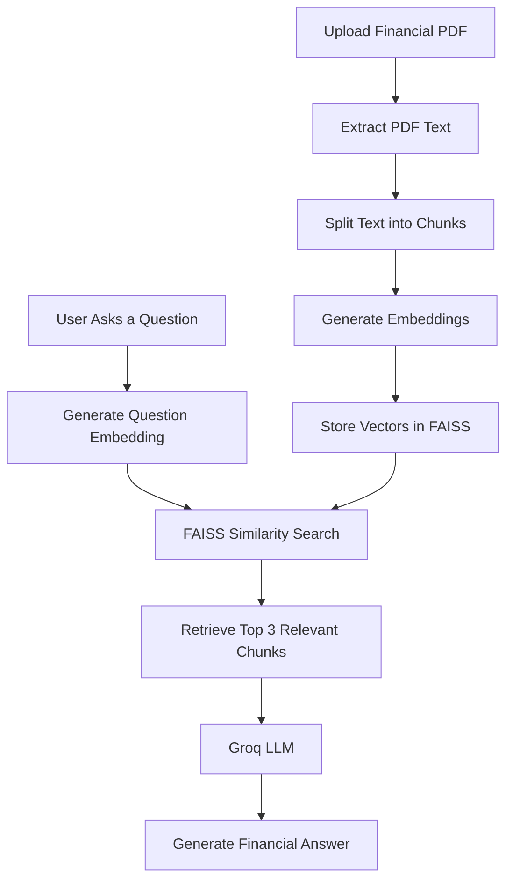

# FinMate AI – Day 5: PDF-Based RAG

## Overview

Implemented a PDF-based RAG system for FinMate AI that allows small business owners to upload financial documents and ask questions about them.

**Sample Business:** Lakshmi General Stores

**Documents Used:**
- Supplier Invoice
- Bank Statement
- Business Loan Summary

## Technologies Used

- Python
- Google Colab
- PyMuPDF – PDF text extraction
- Tesseract OCR – Scanned PDF text extraction
- Sentence Transformers – Text embeddings
- FAISS – Vector storage and similarity search
- NumPy – Numerical operations
- Groq API – AI-generated answers

## Implementation Steps

1. **Install Libraries:** Installed the required packages.
2. **Embedding Models:** Compared `all-MiniLM-L6-v2` and `all-mpnet-base-v2`.
3. **PDF Upload:** Uploaded financial documents.
4. **Text Extraction:** Extracted text using PyMuPDF and OCR.
5. **Text Chunking:** Split text into chunks of 500 characters with 100-character overlap.
6. **Generate Embeddings:** Converted text chunks into numerical vectors.
7. **FAISS Storage:** Stored embeddings in a FAISS index.
8. **Similarity Search:** Retrieved the top 3 relevant chunks for each question.
9. **Groq Integration:** Generated answers using the retrieved PDF content.

## Workflow Chart

## Example Questions

- What is the total invoice amount including GST?
- Who is the supplier?
- What is the closing bank balance?
- What is the loan interest rate?
- What is the loan tenure?

## Key Learnings

- Understanding RAG architecture.
- Working with text embeddings.
- Extracting text from PDF documents.
- Understanding chunking and overlap.
- Using FAISS for similarity search.
- Integrating Groq with a RAG pipeline.

## Result

Successfully built a PDF-based RAG system that retrieves relevant financial information and generates answers using the Groq LLM.

